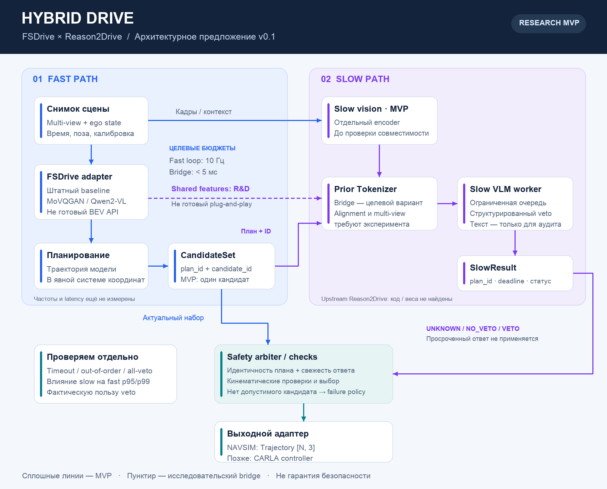

# Computer Vision Vehicle Driving

Учебно-исследовательский проект гибридного агента автономного вождения: FSDrive как baseline планирования, slow VLM для анализа риска и отдельный модуль проверки и выбора траектории.

**Статус:** проектируем и проверяем реализуемость. Реализации агента, обученных весов и результатов экспериментов в этом репозитории пока нет.

## С чего начинаем

1. Проверяем доступность исходников, весов, данных и фактические интерфейсы моделей.
2. Поднимаем воспроизводимый NAVSIM baseline и фиксируем метрики.
3. Проверяем полезность slow veto в offline-абляциях; затем — задержки и устаревшие ответы в temporal replay.
4. После этого исследуем shared-feature bridge, multi-view alignment и closed-loop CARLA.

Сначала используем доступный image-input slow baseline. Передача признаков FSDrive в Reason2Drive без повторного encoder — отдельная исследовательская гипотеза, а не готовое соединение моделей. Целевые `10 Гц` и `<5 мс` не являются измеренными характеристиками.

- [Предложение архитектуры и контракты](docs/architecture.md)
- [План, стартовые задачи и стек](docs/plan.md)
- [Редактируемая SVG-схема](docs/diagrams/architecture.svg) · [Mermaid-источник](docs/diagrams/architecture.mmd)
- [Основной тикет MV-100](https://goddev.youtrack.cloud/issue/MV-100/ComputerVisionVehicleDriving)

## Права

© 2026 Computer Vision Vehicle Driving contributors. Все права сохранены; открытая лицензия на оригинальные материалы пока не выбрана. Права на сторонние модели, код, веса и датасеты определяются их правообладателями. См. [LICENSE](LICENSE).
