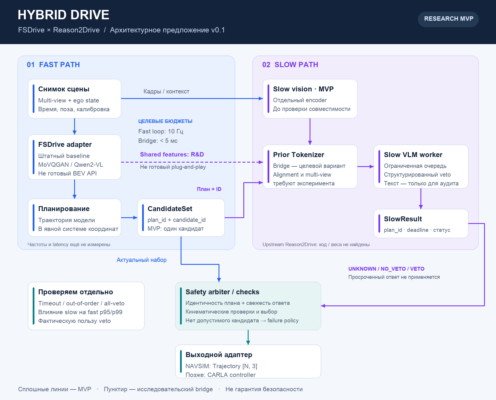

# Архитектура v0.1 — предложение для согласования

Мы проверяем гипотезу: помогает ли slow-контур анализа риска улучшить выбор физически допустимой траектории относительно baseline при приемлемых вычислительных затратах. Снижение столкновений, причинная достоверность объяснений и real-time пока не доказаны. Это исследовательский прототип, не сертифицированная система управления.

---

## Что действительно предоставляют исходные проекты

| Допущение текущих тикетов | Что проверили | Следствие |
|---|---|---|
| FSDrive — готовый 10-Гц planner с `Q_d/Q_l` | FSDrive использует Qwen2-VL и авторегрессионный visual CoT. Кодбук MoVQGAN — не API object/road queries. Шесть изображений присутствуют во входном prompt; генерируемый visual CoT — front-view. | Извлечение семантически подходящих признаков и перенос представления требуют отдельного эксперимента. |
| Reason2Drive можно просто подключить как модель | В публичном upstream доступны README, изображения и ссылка на mini dataset; training/evaluation code остаются TODO. Готовых model checkpoints в проверенном upstream не нашли. | Сначала ищем доступную реализацию/веса. При их отсутствии согласовываем собственную реализацию методики или доступную image-input VLM. |
| FSDrive уже имеет готовые driving-веса | README описывает обучение и inference из локального каталога; ссылки на готовый fine-tuned driving checkpoint не нашли. | До GPU-прогона устанавливаем, какие веса доступны; базовая Qwen2-VL не заменяет driving checkpoint. |
| Bridge — reshape одинаковых тензоров | Reason2Drive описывает EVA-CLIP, Prior Tokenizer и Q-Former; FSDrive использует другое представление. | Нужны alignment data, обучение и ablation против image-input baseline. |
| NAVSIM принимает `[1,10,2]` | `compute_trajectory` возвращает `Trajectory`; `poses` — `[N,3]` с `(x,y,heading)`. Для v1 по умолчанию это 8 поз, 4 с, шаг 0.5 с. | Тензор модели оставляем внутренним; наружу отдаём контракт закреплённой версии NAVSIM. |

Источники: [FSDrive README](https://github.com/MIV-XJTU/FSDrive), [FSDrive paper, §3 и limitations](https://arxiv.org/html/2505.17685v2), [six-camera prompt](https://github.com/MIV-XJTU/FSDrive/blob/main/create_data/prompt_message.py), [состояние public code](https://github.com/MIV-XJTU/FSDrive/issues/41), [Reason2Drive upstream](https://github.com/LogosIntelligenceLab/Reason2Drive), [Reason2Drive paper](https://arxiv.org/html/2312.03661v3), [NAVSIM Agent API](https://github.com/autonomousvision/navsim/blob/v1.1/navsim/agents/abstract_agent.py), [Trajectory](https://github.com/autonomousvision/navsim/blob/v1.1/navsim/common/dataclasses.py).

---

## Границы модулей и поток данных

[Структура файлов, готовые библиотеки и пример движения одного плана](project-structure.md).

1. `SensorAdapter` собирает неизменяемый снимок: кадры, время, ego state, калибровки. Сопоставление камер nuScenes и OpenScene/nuPlan задаём явно, а не заменой путей. Пропуски камер не маскируем под полноценный 360°-вход.
2. `FastAdapter` изолирует upstream FSDrive, preprocessing и преобразование его траектории. MVP допускает один кандидат; генерация нескольких кандидатов не считается штатной возможностью FSDrive.
3. `ContextAdapter / PriorTokenizerBridge` формирует вход slow-модели. В MVP допустим отдельный vision encoder. Целевой shared-feature bridge включаем только после проверки совместимости и обучения; он не владеет выбором траектории.
4. `SlowWorker` получает контекст сцены **и сами проверяемые траектории с `candidate_id`**, асинхронно возвращает структурированный результат `UNKNOWN / NO_VETO / VETO` и необязательное объяснение. Свободный текст не является управляющим протоколом.
5. `SafetyArbiter` проверяет принадлежность и свежесть slow-ответа, объединяет ограничения с независимыми от VLM кинематическими проверками и выбирает допустимый кандидат. Геометрические проверки препятствий/дороги добавляем только при наличии доступного агенту источника объектов и карты с явным producer `WorldSnapshot`; evaluator ground truth не используем как вход агента. Простое veto не исправляет геометрию и не гарантирует безопасность.
6. `TrajectoryAdapter` возвращает `NAVSIM Trajectory`. Позже отдельный `ControllerAdapter` преобразует выбранную траекторию в команды CARLA; он не интерпретирует VQA.

## Контракты до начала реализации

| Данные | Что фиксируем |
|---|---|
| `CameraSnapshot` | `scene_id`, `snapshot_id`, время каждой камеры в общей шкале, `camera_id`, допустимый skew, intrinsics/extrinsics, версия калибровки, ego pose. |
| `FeatureBundle` | `snapshot_id`, encoder/preprocessing version, shape/dtype, семантика признаков, соответствие камерам, владение и срок жизни GPU-буферов. |
| `WorldSnapshot`, если необходим | `t_ref`, координатная система, единицы, боксы/скорости/идентичности объектов, возраст наблюдений. Такой perception-выход не предполагаем готовым в FSDrive. |
| `CandidateSet` | `plan_id`, `t_ref`, reference pose, `candidate_id`, горизонт и временная сетка, оси и единицы. Набор неизменяем после отправки slow-запроса. |
| `Trajectory` | Неизменяемый `float64 [N,3]`: `(x, y, heading)` в ego-системе задней оси на `t_ref`; x вперёд, y влево, метры и радианы. Позы относятся к `dt, 2dt, …, Ndt`; `t=0` — локальный ноль и не входит в массив. Пересэмплирование задаём явно, без экстраполяции; heading интерполируем по кратчайшей дуге. NAVSIM-адаптер копирует в `float32`, не меняя координаты и временную сетку. |
| `SlowRequest / SlowResult` | Запрос содержит контекст и сами траектории с `candidate_id`, координатами, reference pose и временной сеткой. Общие поля: `request_id`, `snapshot_id`, `plan_id`, hash кандидатов, deadline, `valid_until`, model version. Ответ содержит статус и идентификаторы отклонённых кандидатов. |
| `Decision` | Выбранный кандидат, результаты проверок, использованный slow-ответ, возраст данных и причина деградации/fallback. |

Время симуляции и wall-clock deadline — разные поля. Измеряем end-to-end latency, а не только отдельный GPU kernel. Горизонт/оси FSDrive и NAVSIM согласовываем отдельно; короткую траекторию не дополняем молчаливой экстраполяцией.

## Асинхронность и отказоустойчивость

- Ограничиваем slow-очередь; старые ожидающие запросы заменяем более свежими, не накапливая отставание.
- Проверяем `request_id + plan_id + candidate hash`, допустимый возраст и срок действия. Ответы для другого плана, неизвестные ID и invalid output не применяем.
- Маску veto нельзя переносить по индексам на следующий план. В MVP устаревшие ответы отбрасываем. Повторно применимые пространственно-временные ограничения — отдельное будущее решение с повторной валидацией.
- Timeout, отсутствие или ошибка slow-модели означают `UNKNOWN`, а не доказательство отсутствия опасности. Остаются baseline и доступные deterministic checks, с явной отметкой деградации.
- Если все кандидаты отклонены, проверяем заранее подготовленный fallback. При отсутствии допустимого варианта фиксируем failure и выполняем согласованную для конкретного контроллера минимально-рисковую политику. Нулевую скорость и удержание старой команды не считаем автоматически безопасными.
- Shared GPU может сорвать deadline fast-контура. Раздельные streams сами по себе не гарантируют приоритет; измеряем влияние slow-нагрузки, VRAM, OOM и deadline misses. При необходимости изолируем ресурсы.
- Общий encoder означает общий риск ошибки восприятия, а не независимого второго наблюдателя. Текстовое объяснение не доказывает причинную корректность решения.

## Границы экспериментов

**NAVSIM:** качество планов и одинаковые ablations: baseline → checks-only → slow-only → combined. Фиксируем split, версии, метрику, trajectory sampling, camera mapping и источники весов. `main` NAVSIM относится к v2/EPDMS; для начального PDMS-сценария рассматриваем v1.1 с закреплённым commit SHA. Версии и метрики не смешиваем.

**Fallback в offline MVP:** до абляций определяем воспроизводимый fallback `Trajectory`, в том числе для veto единственного кандидата. Например, отдельный тормозной профиль по доступному ego-state с зафиксированными в конфиге ограничениями замедления/jerk; это ещё не выбранная реализация и не гарантия безопасной остановки. Одинаковую fallback-политику используем во всех сравниваемых вариантах. Если допустимого варианта нет, явно считаем failure; сцену не исключаем и `None`/`NaN` не маскируем под валидную траекторию. Если evaluator требует траекторию для каждой сцены, адаптер возвращает заранее определённый fallback с отдельной failure-отметкой, а не объявляет его безопасным.

**Temporal replay:** timeout, out-of-order, invalid/stale result, all-veto, camera drop и конкуренция GPU. Считаем долю slow-ответов, реально применённых к актуальному плану, deadline misses и fast p50/p95/p99. Если почти все veto приходят поздно, ускорение Bridge само по себе не решит проблему.

**CARLA / Bench2Drive:** отдельный последующий этап для взаимодействия с контроллером и замкнутым контуром. NAVSIM не доказывает real-time корректность асинхронного управления. Версию симулятора и benchmark-протокол фиксируем отдельно.

Источники: [NAVSIM v1 paper](https://arxiv.org/html/2406.15349v2), [NAVSIM versions](https://github.com/autonomousvision/navsim), [NAVSIM metrics](https://github.com/autonomousvision/navsim/blob/main/docs/metrics.md), [Bench2Drive](https://github.com/Thinklab-SJTU/Bench2Drive).
