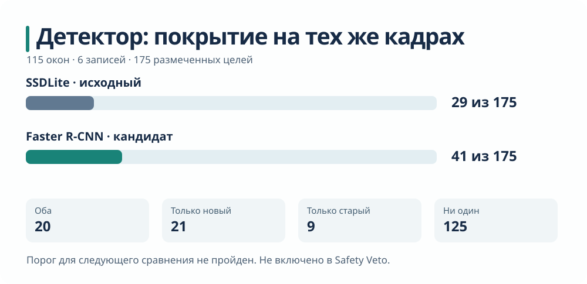

# Покрытие детектора: SSDLite и Faster R-CNN

**Порог для следующего сравнения не пройден.** Сопоставлено **29 → 41** из 175 целей. Проверили 115 тех же окон из 6 записей.

| Срез | Цели | SSDLite | Faster R-CNN |
|---|---:|---:|---:|
| Все | 175 | 29 | 41 |
| Движущиеся | 106 | 13 | 26 |
| Неподвижные | 63 | 16 | 15 |
| Промежуточное смещение | 6 | 0 | 0 |

На **20** общих целях сравниваем среднюю ошибку центра 0.857 м → 0.795 м. Улучшились 3 из 6 записей.

## Что именно изменили

Сравнили два замороженных профиля. SSDLite использует полные кадры и фронтальные кропы; Faster R-CNN — шесть полных кадров и фиксированный вход 640–1120 px. Одни и те же выпрямленные снимки, способ проекции и правила сопоставления. Детекции проверяем по текущим центрам, а не по столкновениям. Неполная разметка не позволяет оценивать долю ложных рамок.

Порог для следующего прогона трекера: +15 совпадений, ≥4 улучшенных записей, ≥12 общих целей и рост средней ошибки на них ≤0,20 м. Пять заранее выбранных окон независимо повторили до меток. Штатная цепочка и Veto не менялись.

Агрегаты и SHA: [JSON](detector-coverage-v1.json). [Протокол и запуск](../detector-coverage.md) · [Проверенная версия кода](https://github.com/lDizil/computer-vision-vehicle-driving/commit/fbad7e0c22b25736de1eb5f400140e50e772125a) · [Документация Faster R-CNN](https://docs.pytorch.org/vision/0.15/models/generated/torchvision.models.detection.fasterrcnn_mobilenet_v3_large_fpn.html).
